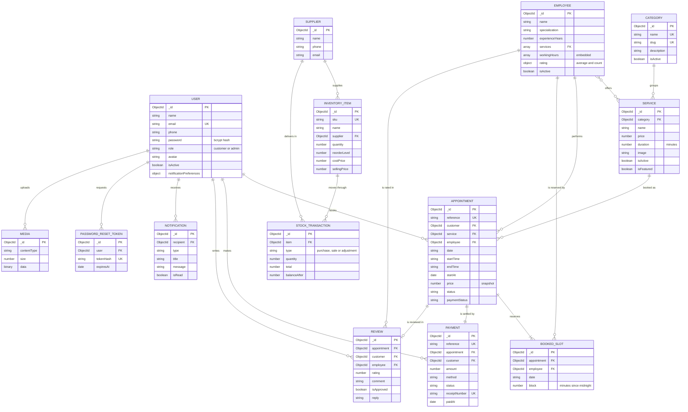

# Database Design

The system uses **MongoDB** with **Mongoose**. Each collection has a schema in `backend/models/` that defines its fields, validation rules and indexes.

## From tables to collections

The project brief lists relational tables. This is how each one is implemented in MongoDB:

| Table in the brief | MongoDB implementation | Notes |
|---|---|---|
| `users` | `users` collection | Accounts for customers and administrators, distinguished by `role` |
| `customers` | `users` with `role: "customer"` | Profile fields live on the user document, so no join is needed |
| `employees` | `employees` | |
| `availability` | `employees.workingHours` (embedded) | One entry per weekday; always read together with the employee |
| `services` | `services` | |
| `categories` | `categories` | |
| `appointments` | `appointments` and `bookedslots` | `bookedslots` enforces the no-double-booking rule |
| `payments` | `payments` | One per appointment |
| `reviews` | `reviews` | One per completed appointment |
| `notifications` | `notifications` | One per recipient |
| `gallery` | `galleryitems` | |
| `inventory` | `inventoryitems` and `suppliers` | |
| `sales` | `stocktransactions` | Purchases, sales and adjustments in one audit trail |
| `settings` | `settings` | A single document (`key: "main"`) |
| `password_reset_tokens` | `passwordresettokens` | Expire automatically through a TTL index |
| *(added)* | `media` | Uploaded images stored as binary |
| *(added)* | `contactmessages` | Messages from the contact form |

### Design principles

- **Reference what is shared, embed what is owned.** Appointments reference the customer, service and employee because those records are shared. Working hours and opening hours are embedded because they belong to exactly one parent and are small and bounded.
- **Snapshot values that must not change.** An appointment stores the `price` and `duration` at the time of booking, so later price changes never rewrite history.
- **No repeated data.** Totals such as a customer's spending are calculated with aggregation queries. The only cached value is a stylist's average rating, which is refreshed whenever a review changes.
- **Let the database enforce the rules that matter.** Unique indexes guarantee one account per email, one payment and one review per appointment, and one booking per stylist per 15-minute block.

## Entity relationship diagram

`SETTING`, `GALLERY_ITEM` and `CONTACT_MESSAGE` stand alone and have no relationships.

## Collections

Every collection also has `createdAt` and `updatedAt` timestamps.

### users

| Field | Type | Rules |
|---|---|---|
| `name` | String | Required, up to 100 characters |
| `email` | String | Required, unique, lower case |
| `phone` | String | Up to 20 characters |
| `password` | String | Required; bcrypt hash; never returned by the API |
| `role` | String | `customer` (default) or `admin` |
| `avatar` | String | Image URL |
| `address` | String | Up to 250 characters |
| `isActive` | Boolean | Deactivated users cannot sign in |
| `notificationPreferences` | Object | `{ email: Boolean, sms: Boolean }` |
| `passwordChangedAt` | Date | Used to invalidate older tokens |
| `lastLoginAt` | Date | |

### employees

| Field | Type | Rules |
|---|---|---|
| `name` | String | Required |
| `email`, `phone` | String | Visible to administrators only |
| `photo` | String | Image URL |
| `bio`, `specialization` | String | |
| `experienceYears` | Number | 0 to 60 |
| `services` | [ObjectId → services] | Empty means the stylist performs every service |
| `workingHours` | Array | Seven entries: `{ day, isWorking, start, end }` |
| `rating` | Object | `{ average, count }`, cached from approved reviews |
| `isActive` | Boolean | |

### categories and services

| Collection | Fields |
|---|---|
| `categories` | `name` (unique), `slug` (unique, generated), `description`, `image`, `isActive` |
| `services` | `name`, `description`, `category` (→ categories), `price`, `duration` (minutes, multiple of 15), `image`, `isActive`, `isFeatured` |

### appointments

| Field | Type | Rules |
|---|---|---|
| `reference` | String | Unique, for example `APT-20261012-7F3K9Q` |
| `customer` | ObjectId → users | Required |
| `service` | ObjectId → services | Required |
| `employee` | ObjectId → employees | Required |
| `date` | String | `YYYY-MM-DD`, salon local date |
| `startTime`, `endTime` | String | `HH:mm`, salon local time |
| `startAt`, `endAt` | Date | The same moments in UTC, used for sorting, reminders and reports |
| `duration`, `price` | Number | Snapshots taken when booking |
| `status` | String | `pending`, `confirmed`, `completed`, `cancelled`, `rejected`, `no_show` |
| `paymentMethod` | String | `cash`, `pos`, `bank_transfer`, `paystack` |
| `paymentStatus` | String | `unpaid`, `paid`, `refunded` |
| `notes`, `cancelReason` | String | |
| `cancelledBy` | ObjectId → users | |
| `reminderSentAt` | Date | Ensures one reminder per appointment |

### bookedslots

One document per 15-minute block reserved for a stylist.

| Field | Type |
|---|---|
| `appointment` | ObjectId → appointments |
| `employee` | ObjectId → employees |
| `date` | String (`YYYY-MM-DD`) |
| `block` | Number (minutes since midnight) |

A 60-minute appointment at 09:00 creates blocks 540, 555, 570 and 585.

### payments

| Field | Type | Rules |
|---|---|---|
| `reference` | String | Unique payment ID, for example `PAY-20261012-A1B2C3` |
| `appointment` | ObjectId → appointments | Unique: one payment per appointment |
| `customer` | ObjectId → users | |
| `amount`, `currency` | Number, String | |
| `method` | String | `cash`, `pos`, `bank_transfer`, `paystack` |
| `status` | String | `pending`, `success`, `failed`, `refunded`, `cancelled` |
| `providerReference` | String | Paystack transaction reference |
| `receiptNumber` | String | Unique, assigned on payment |
| `paidAt`, `refundedAt` | Date | |
| `recordedBy` | ObjectId → users | The administrator who recorded it |
| `note` | String | |

### reviews, notifications and password reset tokens

| Collection | Fields |
|---|---|
| `reviews` | `customer`, `appointment` (unique), `service`, `employee`, `rating` (1 to 5), `comment`, `isApproved`, `reply` |
| `notifications` | `recipient`, `type`, `title`, `message`, `link`, `isRead` (removed automatically after 90 days) |
| `passwordresettokens` | `user`, `tokenHash` (unique), `expiresAt`, `usedAt` (removed automatically when expired) |

### inventory

| Collection | Fields |
|---|---|
| `suppliers` | `name`, `contactPerson`, `phone`, `email`, `address`, `isActive` |
| `inventoryitems` | `name`, `sku` (unique), `category`, `supplier`, `quantity`, `unit`, `reorderLevel`, `costPrice`, `sellingPrice`, `isActive` |
| `stocktransactions` | `item`, `type`, `quantity`, `unitPrice`, `total`, `supplier`, `note`, `balanceAfter`, `createdBy` |

A product is "low stock" when `quantity <= reorderLevel`.

### settings, gallery, media and contact messages

| Collection | Fields |
|---|---|
| `settings` | `businessName`, `tagline`, `about`, `logo`, `address`, `email`, `phone`, `currency`, `timezone`, `openingHours[]`, `slotIntervalMinutes`, `cancellationWindowHours`, `socialLinks` |
| `galleryitems` | `title`, `category`, `image`, `isActive` |
| `media` | `filename`, `contentType`, `size`, `data` (binary), `uploadedBy` |
| `contactmessages` | `name`, `email`, `phone`, `subject`, `message`, `isRead` |

## Indexes

| Collection | Index | Purpose |
|---|---|---|
| `users` | `email` unique | One account per email |
| `users` | `role` | Listing customers |
| `bookedslots` | `(employee, date, block)` unique | **Prevents double booking** |
| `bookedslots` | `appointment` | Releasing an appointment's slots |
| `appointments` | `reference` unique | Lookup by booking reference |
| `appointments` | `customer`, `(employee, date)`, `(status, startAt)`, `startAt` | Lists, schedules, reminders, reports |
| `payments` | `reference` unique, `appointment` unique, `receiptNumber` unique (sparse) | Integrity |
| `payments` | `customer`, `status`, `paidAt` | Lists and revenue reports |
| `reviews` | `appointment` unique | One review per appointment |
| `categories` | `name` unique, `slug` unique | |
| `inventoryitems` | `sku` unique | |
| `passwordresettokens` | `tokenHash` unique, TTL on `expiresAt` | Single use, automatic expiry |
| `notifications` | `(recipient, isRead, createdAt)`, TTL of 90 days | Bell dropdown, automatic clean-up |

## Migration scripts

MongoDB has no table definitions to run, so migrating means creating the collections and bringing their indexes in line with the schemas.

| Script | Command | What it does |
|---|---|---|
| `backend/database/migrate.js` | `npm run migrate` | Creates every collection, synchronises indexes, creates the settings document and the first administrator. Safe to run repeatedly |
| `backend/database/seed.js` | `npm run seed` | Loads demo data into an empty database |
| | `npm run seed -- --fresh` | Erases all data first |

Run `npm run migrate` after deploying a version that changes any index.
