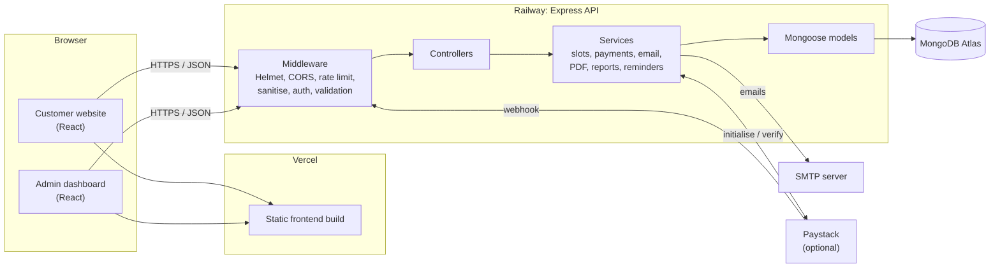
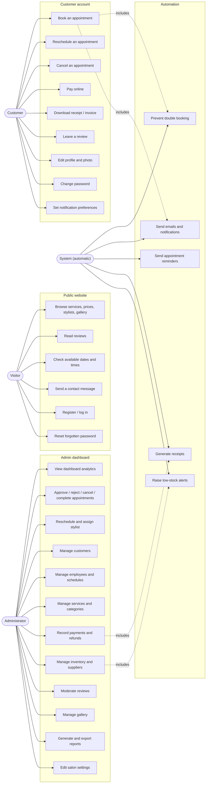
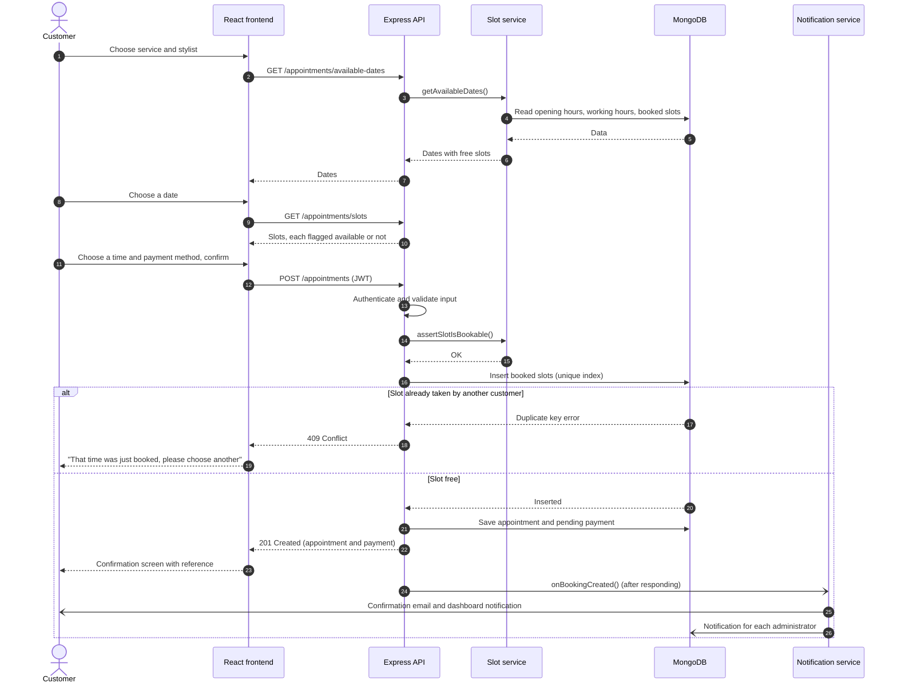
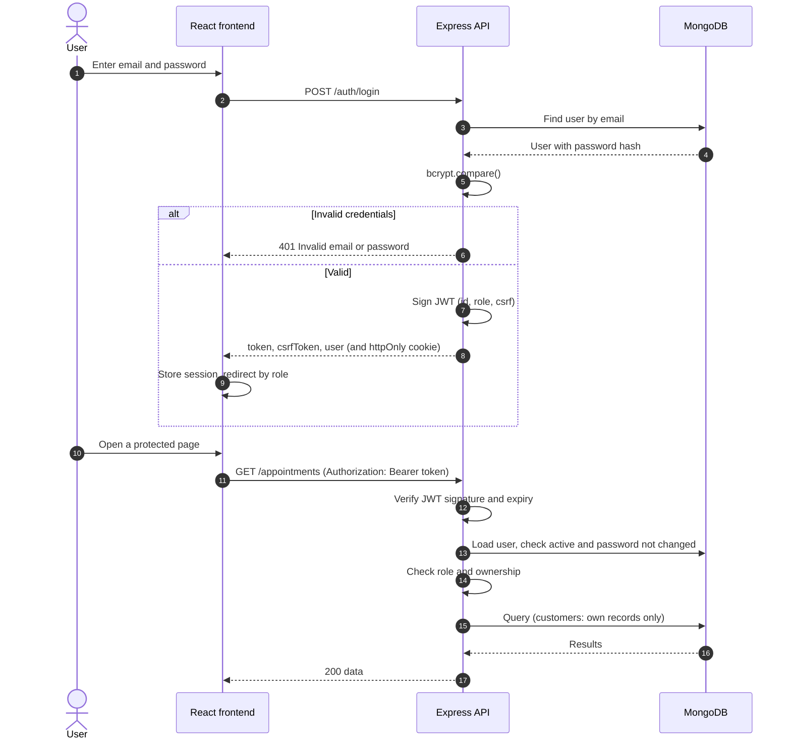
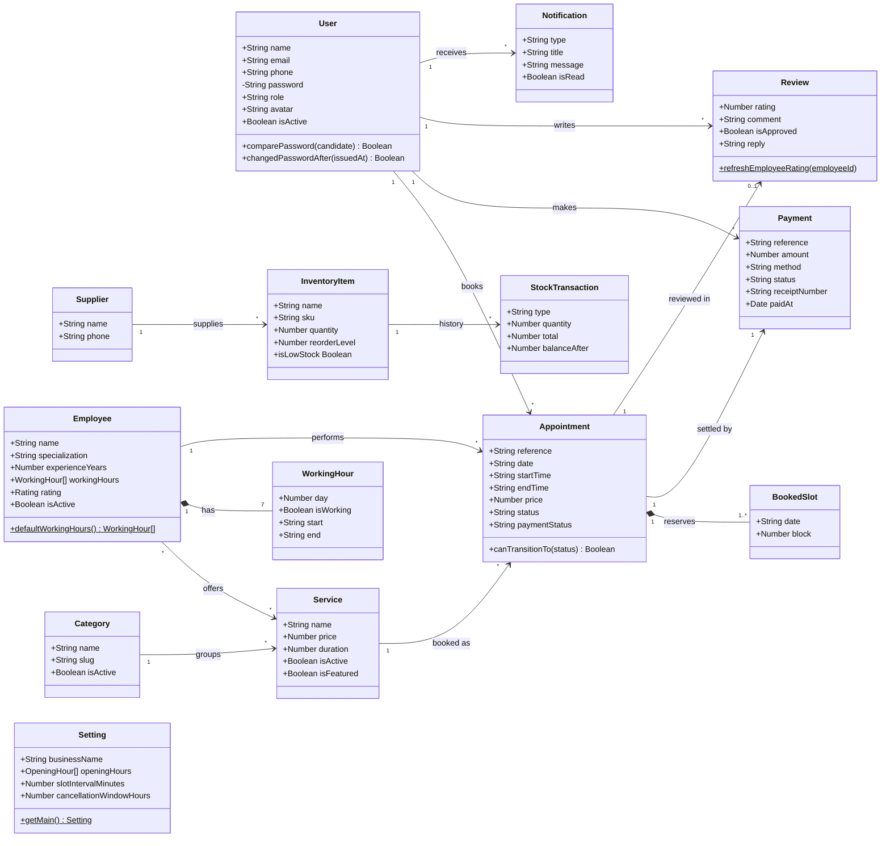
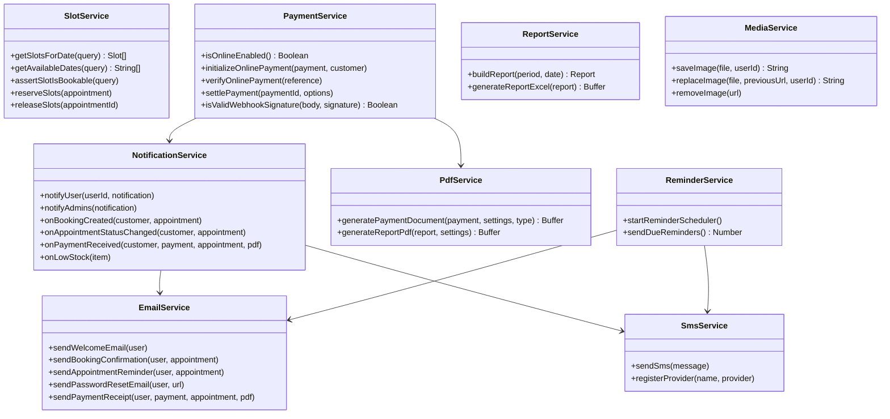
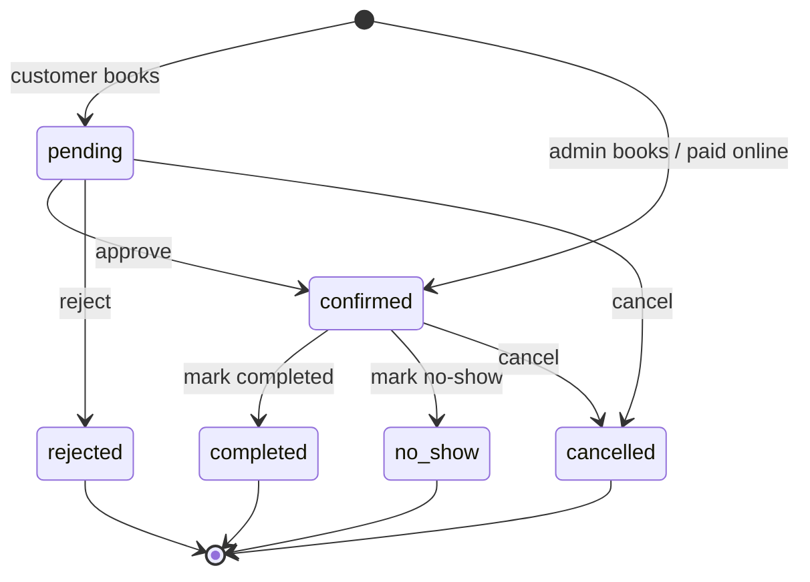

# System Diagrams

The diagrams are written in [Mermaid](https://mermaid.js.org), which GitHub and VS Code (with a Mermaid extension) render automatically. To export an image for a report, paste a diagram into <https://mermaid.live>.

The ER diagram is in [DATABASE.md](DATABASE.md).

## 1. System architecture



## 2. Use case diagram



A customer can do everything a visitor can.

## 3. Sequence diagram: booking an appointment



## 4. Sequence diagram: online payment

```mermaid
sequenceDiagram
    autonumber
    actor C as Customer
    participant F as React frontend
    participant A as Express API
    participant P as Paystack
    participant D as MongoDB

    C->>F: Confirm and pay
    F->>A: POST /payments/initialize
    A->>P: Initialise transaction (amount, reference)
    P-->>A: Checkout URL
    A->>D: Save provider reference on the payment
    A-->>F: Checkout URL
    F->>P: Redirect customer to checkout
    C->>P: Enter card details and pay
    P-->>F: Redirect to /payment/callback?reference=...
    F->>A: POST /payments/verify
    A->>P: Verify transaction
    P-->>A: Status and amount

    alt Successful and amount matches
        A->>D: Payment = success, receipt number issued
        A->>D: Appointment = paid and confirmed
        A-->>F: Payment verified
        F-->>C: Success page with receipt download
        A-)C: Receipt email with PDF attached
    else Failed or abandoned
        A->>D: Payment = failed
        A-->>F: 400 Payment was not successful
        F-->>C: Explain; booking is kept, can retry or pay at salon
    end

    Note over P,A: Paystack also calls the webhook, so the payment<br/>is recorded even if the customer closes the browser.
```

## 5. Sequence diagram: login and an authorised request



## 6. Class diagram

Domain model. Methods shown are the important behaviours of each model.



### Service layer



## 7. Appointment state diagram



Time slots are held while an appointment is `pending` or `confirmed` and released when it is `cancelled`, `rejected` or `no_show`.
